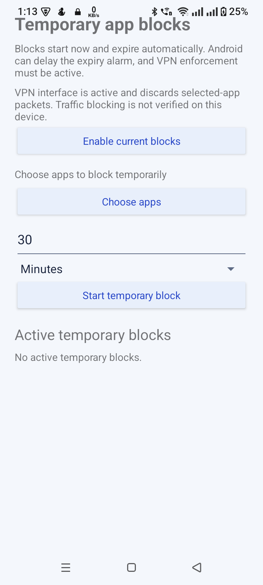
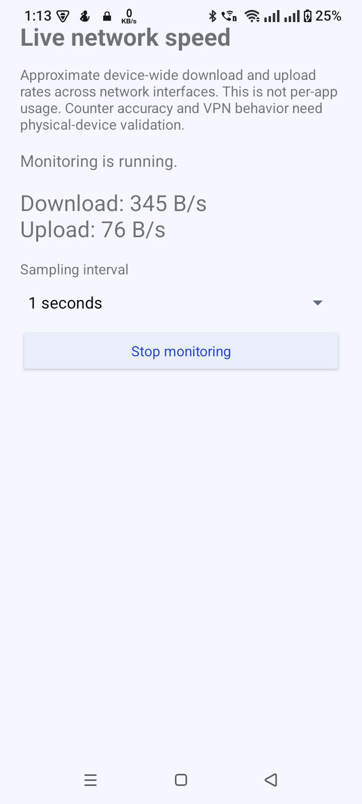

# App Internet Control

**Explore local rules for per-app internet access on Android.** App Internet Control is a native Kotlin prototype for trying app selection, Wi-Fi-based access rules, schedules, temporary blocks, focus modes, and local network-usage tools. It is intended for development and evaluation; it is not a verified firewall.

> [!WARNING]
> **Traffic blocking is experimental and unverified.** The current VPN packet reader discards selected-app packets instead of forwarding them. Selected apps may lose connectivity, and saved rules or an active VPN do not prove a reliable block or allow policy is working. Do not rely on this app for security, parental-control, or safety-critical restrictions.

## Why use it?

Android does not give ordinary third-party apps a general control for changing another app’s Wi-Fi or mobile-data permission. App Internet Control brings local rule ideas together so developers and testers can explore app selection, Wi-Fi conditions, time windows, and usage displays. Rules and statistics are stored on the device; network enforcement remains an experimental prototype.

## Features

### Local app controls

- **Installed-app list and search — Implemented.** Shows launchable apps with their Android launcher icons and local selection controls. Android package visibility means this is not a list of every installed package.
- **Manual app selection — Experimental.** Selections persist locally. The current VPN packet path does not forward routed packets, so the control cannot guarantee internet blocking and may interrupt connectivity.
- **Wi-Fi-based app access rules — Experimental.** Users can save a rule for the currently connected Wi-Fi and choose apps for it. Network transitions, background recovery, and general traffic enforcement are not verified.
- **Schedules and temporary blocks — Experimental.** Local time windows, overnight schedules, and timed rules are present. Android and device-maker background restrictions can delay transitions; do not depend on precise expiry.
- **Focus modes — Prototype.** Local modes can be saved and activated. State rendering has automated coverage; traffic enforcement is unverified.

### Local network tools

- **Change history — Available locally.** Records rule requests and their source. An “active” or “pending” entry does not prove traffic was blocked.
- **Live network speed — Partial.** Estimates aggregate device-wide receive/send rates using Android traffic counters and can show an ongoing notification. It is not per-app speed.
- **Usage history and analytics — Implemented; coverage unverified.** Uses Android Usage Access and network-statistics APIs after the user enables local collection. Results can have gaps, shared-UID attribution, or OEM/API differences.
- **Update notice — Configured for this release candidate.** The app checks an HTTPS JSON manifest and opens the official GitHub Releases page. It never downloads or silently installs an APK. The public manifest and release are not available until the maintainer publishes them.

The current app has no account, cloud backup, profile, ad-blocking, or Play In-App Updates feature.

## Screenshots

Genuine captures from a version 1.0 debug build running on a Realme RMX3834 / Android 15 / API 35. They show UI state only and do not demonstrate network enforcement; the current 1.0.1 release candidate is not represented or device-verified by these images. Device-specific app inventory, Wi-Fi identity, and usage history are omitted.

| Temporary blocks | Live network speed |
| --- | --- |
|  |  |

The update/about screenshot was omitted because it shows an older version and pre-release update configuration. See [SCREENSHOT_CHECKLIST.md](SCREENSHOT_CHECKLIST.md) for additional privacy-safe captures that would improve the gallery.

## How it works

The app saves manual selections, Wi-Fi rules, schedules, temporary blocks, focus modes, change history, speed preferences, and usage records in app-local storage. Rules are combined locally to calculate an effective set of apps.

When enforcement is enabled, Android asks the user to approve a `VpnService`. The current service routes selected-app traffic into a local VPN interface and discards packets read from it; it does not forward them to the internet. This can make an app lose connectivity and does not provide a complete firewall. VPN state and UI labels are not evidence of traffic being blocked or restored.

Wi-Fi rules use an identifier for the currently connected network. Ordinary apps cannot enumerate every saved Wi-Fi network, so the user must connect to the intended network to capture its identifier. Android permissions and device-maker behavior can affect whether the identifier is available.

## Download and installation

The intended official download page is [GitHub Releases](https://github.com/itsmebillah/app-internet-control/releases/latest). **The production-signed v1.0.1 APK has been built and verified locally, but the GitHub Release has not yet been published**, so there is no public APK download there yet. Do not treat a debug APK as a release.

When a signed release is available:

1. Download the APK asset from the official GitHub Releases page.
2. Open the downloaded APK. Android may ask you to allow your browser or file manager to install unknown apps; grant that setting only if you trust the source and want to proceed.
3. Review Android’s package installer prompt and install.
4. On first use, explore the local UI without enabling VPN enforcement. If you choose to enable the VPN prototype, Android displays its own consent prompt. The current VPN discards routed packets, so selected apps may lose connectivity.

For a development build, use Android Studio and the Android SDK, then run:

```powershell
git clone https://github.com/itsmebillah/app-internet-control.git
cd app-internet-control
.\gradlew.bat testDebugUnitTest assembleDebug --no-daemon --console=plain
```

The debug APK is at `app\build\outputs\apk\debug\app-debug.apk`. It is for development and evaluation, not production distribution. Current project settings: minimum SDK 29 (provisional), compile/target SDK 37, Android Gradle Plugin 9.4.0, Gradle 9.6.0, and JDK 21.

## Updates

The app compares numeric `versionCode` values from a public HTTPS JSON manifest and offers a link to the official release page. It does not download or install APK files. A user can choose **Later** for an optional update; a minimum-version notice may be shown for older versions but does not block app startup. The release manifest must only be published after its matching signed release is available.

Google Play users should receive updates through Google Play. Play In-App Updates are not implemented; the external APK flow is for direct GitHub distribution only.

## Permissions and Android access

Access is used only by its related feature. Android controls special access and VPN consent; this app cannot grant those on the user’s behalf.

| Permission or access | Why it is used |
| --- | --- |
| Android VPN consent (`VpnService`) | Creates the user-approved local VPN interface for the experimental routing prototype. |
| `ACCESS_FINE_LOCATION` and device Location setting, when required | Android treats connected Wi-Fi identifiers as location-sensitive. The app compares a local network identifier; it does not derive physical location. |
| `ACCESS_WIFI_STATE`, `ACCESS_NETWORK_STATE` | Reads Wi-Fi/network state for Wi-Fi-rule monitoring and connectivity status. |
| `POST_NOTIFICATIONS` (Android 13+) | Lets Android display ongoing VPN and speed-monitor foreground notifications. |
| Alarms & reminders special access (`SCHEDULE_EXACT_ALARM`) | Supports more punctual schedule boundaries where available. Android may delay fallback alarms. |
| Usage Access (`PACKAGE_USAGE_STATS`) | User-granted Settings access for local usage-statistics collection. It is not a normal runtime permission. |
| `INTERNET` | Supports network-related components and the configured HTTPS update-manifest check. |
| Foreground-service and boot declarations | Meet Android service requirements and help restore schedule alarms after reboot; they do not grant unrestricted background execution. |

The app declares launcher-intent package visibility rather than `QUERY_ALL_PACKAGES`. It lists launchable apps visible to Android, not every installed package.

## Limitations and tested environment

- The VPN packet path is discard-only. Reliable per-app blocking, allow rules, DNS filtering, and internet restoration are unverified.
- Wi-Fi rules, schedules, focus modes, and timed blocks have limited checks on one Realme RMX3834 running Android 15/API 35. API 29, API 34, and API 37/current-device compatibility is incomplete.
- Background alarm timing, process death, reboot recovery, Doze, mobile-data transitions, IPv4/IPv6, DNS, other device makers, and simultaneous VPNs need testing.
- Schedule expiry delays were observed on the Realme test phone. Do not depend on exact transition time.
- Speed values are approximate device-wide counters and may be unavailable, reset, or delayed.
- Usage records begin after collection is enabled. Android can return incomplete windows or group several apps under a shared UID.
- Minimum SDK 29 remains provisional; the single API 35 test device does not establish broad compatibility.
- The v1.0.1 source changes are on `main` and the signed APK is prepared locally; the GitHub Release, public APK download, and active update manifest are still pending publication.

## Privacy and data handling

Selections, schedules, Wi-Fi rules, focus modes, history, and usage records are stored in app-local storage. Usage collection is user-started and can be paused or cleared. Android app backup is disabled. Wi-Fi network identifiers are used locally by Wi-Fi rules. The app has no sign-in, cloud sync, account backup, or remote usage analytics. The update checker requests a small public manifest over HTTPS; tapping **Update** opens GitHub Releases in a browser.

Screenshots in this repository are genuine captures from a test device. Review them for private details before sharing elsewhere. Do not include credentials, tokens, Wi-Fi identifiers, usage records, or personal app inventories in reports.

## Troubleshooting

- **A selected app loses internet:** turn off the relevant rule and stop the VPN. The current VPN discards routed packets and cannot guarantee normal pass-through connectivity.
- **VPN consent was declined:** start the feature again and respond to Android’s VPN prompt.
- **A Wi-Fi rule cannot identify the network:** connect to the intended Wi-Fi, grant the requested location access, and enable the device Location setting if Android requires it.
- **A schedule starts or ends late:** check Alarms & reminders access and device battery/background restrictions.
- **Live speed will not start:** allow App Internet Control notifications and its Live network speed notification channel.
- **Usage history is empty:** grant Usage Access in Android Settings, then start local collection. Earlier system history is not imported.
- **Update check fails:** check the internet connection. The public manifest and release must be published before the update feed is available.

## Roadmap

1. Design and verify a safe forwarding-capable VPN before presenting traffic blocking as reliable.
2. Validate Wi-Fi and schedule transitions across the planned Android/API and device-maker matrix.
3. Recheck focus-mode UI state on-device and review accessibility, loading, and error states across screens.
4. Validate speed and usage-counter coverage and background behavior on real devices.
5. Publish and verify the first signed release and its update manifest. Play Store users should receive updates through Google Play.

## Contributing and contact

Bug reports and pull requests are welcome. Include device manufacturer/model, Android version/API, reproduction steps, and sanitized logs. Do not attach Wi-Fi identifiers, usage records, credentials, tokens, or other personal data. Before submitting code, run:

```powershell
.\gradlew.bat testDebugUnitTest assembleDebug --no-daemon --console=plain
```

Use [GitHub Issues](https://github.com/itsmebillah/app-internet-control/issues) for questions and bug reports. There is no `LICENSE` file; a license choice needs owner confirmation, and reuse or redistribution rights are not granted by this repository.

## Project documents

- [Master plan](MASTER_PLAN.md)
- [Development plan and verification history](DEVELOPMENT_PLAN.md)
- [Physical-device test plan](PHYSICAL_DEVICE_TEST_PLAN.md)
- [Screenshot checklist](SCREENSHOT_CHECKLIST.md)
- [Release/update workflow](UPDATE_RELEASE.md)
